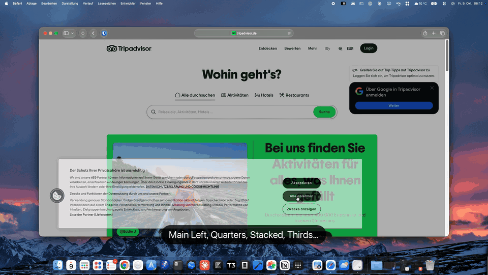
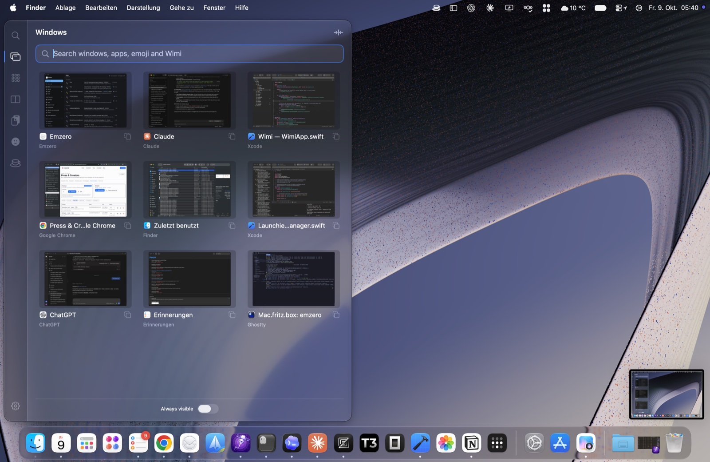
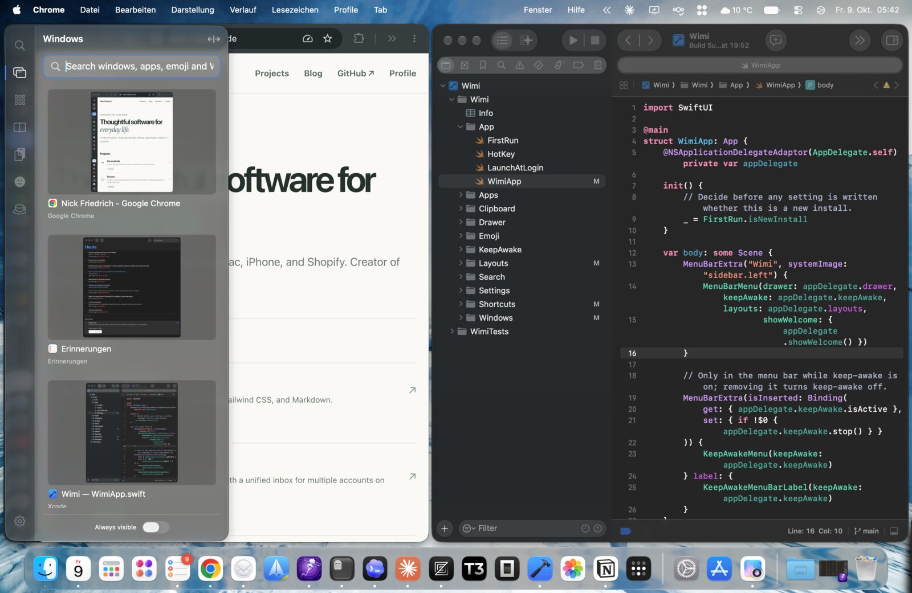
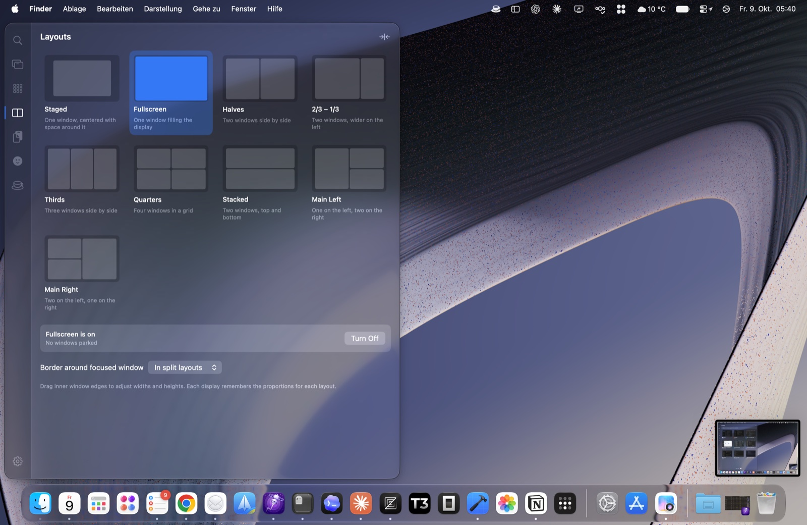
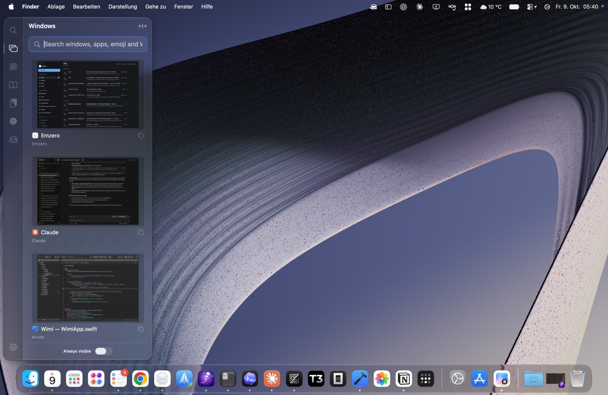
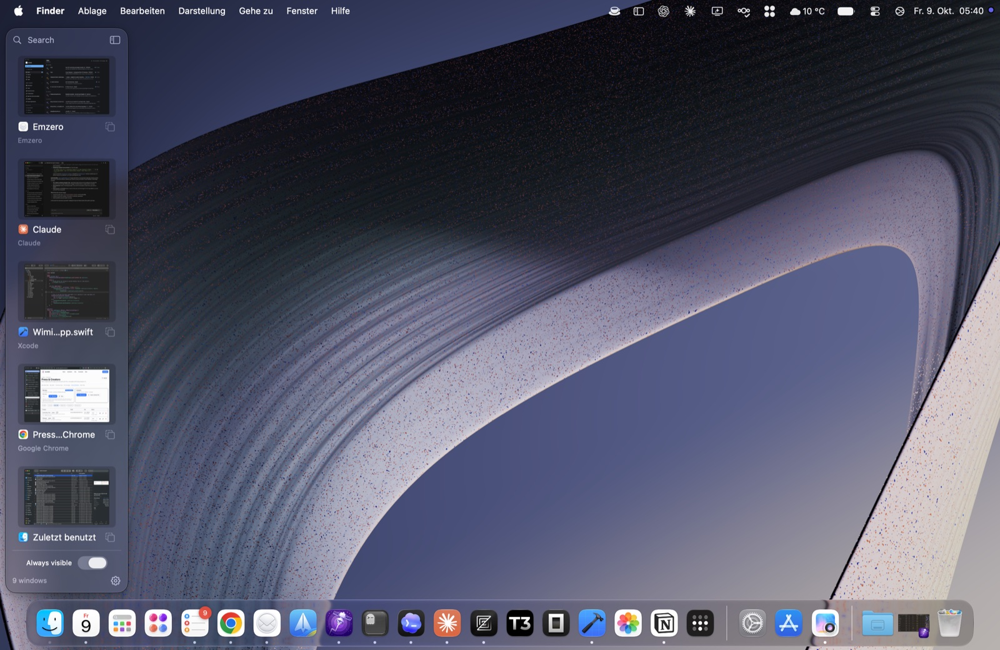

# Wimi — Window Manager Improved

A macOS menu bar app that puts window switching, window layouts, an app launcher, search, emoji and an optional clipboard history in one drawer that slides in from the edge of the screen.

> Wimi is closed source. This repository is used only for **downloads, release notes and feedback**.

> [!NOTE]
> **Wimi is free to use.** **Wimi Pro** adds advanced layouts, workspaces, clipboard history and more for **$19.99 once** (plus tax, no subscription, 2 Macs). Every download starts with **30 days of Pro**, no account or card needed. Afterwards Wimi keeps working on the free plan. **[Pricing and launch offer →](https://getwimi.app/#pricing)**



▶️ **[Watch the full 45-second demo](media/wimi-demo.mp4)**





| Layouts | Compact drawer | Always-visible strip |
|---|---|---|
|  |  |  |

## Download

Get the latest `.dmg` from **[Releases](../../releases/latest)**, open it, and drag Wimi into Applications.

- Requires macOS 14 Sonoma or later
- Universal build (Apple silicon and Intel)
- Signed with a Developer ID and **notarized by Apple**, so Gatekeeper opens it without any workarounds

### Verify the download (optional)

Every release lists the SHA-256 checksum of its DMG. To check yours:

```sh
shasum -a 256 ~/Downloads/Wimi-*.dmg
```

## Features

### Free

- **Drawer:** slides in when the mouse rests at a screen edge, or opens with a shortcut. Works on multiple displays.
- **Window switcher:** every open window with live previews. Hold ⌥Tab to switch, with search and keyboard navigation.
- **Layouts:** Fullscreen, Staged (one window, centered) and Halves for each display, with animated placement. Drag a window onto a slot to place it, or use the keyboard: Hyper + arrows moves focus, Hyper ⇧ + arrows swaps windows, Hyper R rotates them.
- **Global search:** one search across windows, apps, layouts and actions. Start typing anywhere in the drawer.
- **App launcher:** an icon grid with search that learns which apps you open most.
- **Emoji picker:** search, recents, and insertion into the current app.
- **Keep Awake:** stop the Mac from sleeping for a set time.
- **Hyper key:** optionally turns Caps Lock into ⌃⌥⌘ for your own shortcuts.

### Pro

- **Advanced layouts:** thirds, quarters, 2/3–1/3, stacked and main+side layouts.
- **Staged window size:** size the staged window with a slider or by dragging its edges, per display and workspace.
- **Workspaces:** Hyper 1–9 switches between nine workspaces with a slide; Hyper ⇧1–9 sends the focused window to one.
- **Workspace bar:** every workspace and that display's windows in a bar on each display, plus the workspace number in the menu bar.
- **Always-visible strip:** a slim window strip that stays on screen.
- **Clipboard history:** text and images, search, paste. Off until you turn it on.
- **Glass themes:** Glass, Liquid Glass, Sheet and Midnight backgrounds.

Buy Pro from Settings → License in Wimi, or on [getwimi.app](https://getwimi.app/#pricing). Your license key comes by email and works on two Macs.

## Permissions

- **Accessibility:** required to list, focus and move windows.
- **Screen Recording:** optional, used only for live window previews.

## Privacy

Window history and clipboard data stay on your Mac. Wimi talks to the network only for:

- **Updates:** once a day it loads the release list (`appcast.xml`) from this repo. You can turn this off in Settings → General.
- **Your Pro license:** entering a key activates it with [Polar](https://polar.sh), our payment provider, which checks it again when Wimi starts.
- **One anonymous event when your trial starts:** just the event and the Wimi version, no names or IDs. Turn it off on the welcome screen or in Settings → General → Privacy.

Details in the [privacy policy](https://getwimi.app/privacy).

## Changelog

See [CHANGELOG.md](CHANGELOG.md) for what changed in each version.

## Feedback

Found a bug or have an idea? [Open an issue](../../issues), email [info@getwimi.app](mailto:info@getwimi.app), or use Settings → Feedback in Wimi.

## Uninstall

Quit Wimi from the menu bar and move it from Applications to the Trash.
